# NasFlow

> 一个把 NAS 日常用顺的移动端客户端（原 Synology Cloud）：文件、相册、视频、音乐、笔记、电子书、离线下载、套件与系统管理，全部收进一个 App。

⭐ **欢迎 Star！您的支持是我们持续完善的动力**。

------

## 一分钟了解

| Type | Description |
| --- | --- |
| 平台 | Android、iOS |
| 技术栈 | Flutter + Dart，原生能力用 Java/Kotlin 补充 |
| 界面 | 26.11 起整套自绘组件改版，手机 / Pad / 横竖屏统一适配 |
| 后端 | 直接对接 DSM 各套件 API，无需自建服务 |
| 下载 | [👉官网获取](http://zhanglei.nasfuns.fun:4001/website/) |
| 协议 | GPL-3.0 |
| 用户交流 | 👉 [点击加入](http://zhanglei.nasfuns.fun:4001/wechat-qr.png) |

------

## 界面速览

<table>
  <tr>
    <td align="center">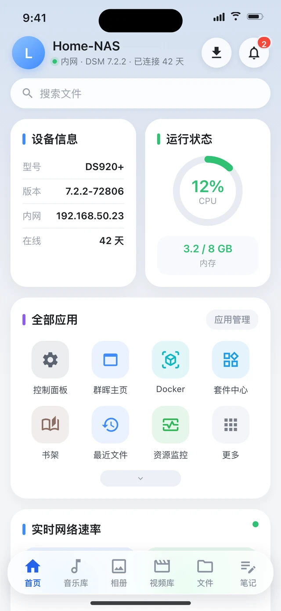<br/>首页</td>
    <td align="center">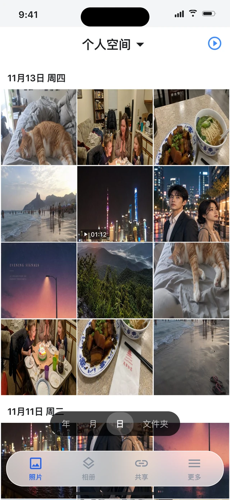<br/>相册时间线</td>
    <td align="center">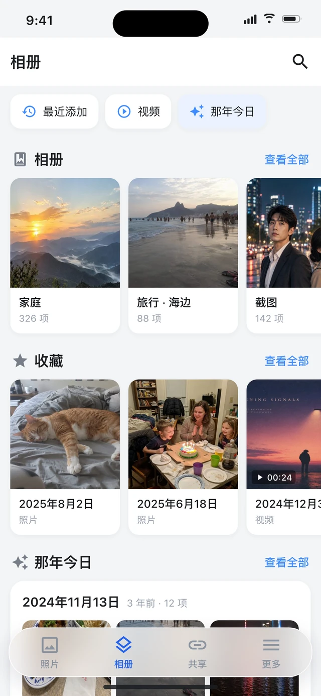<br/>那年今日</td>
    <td align="center">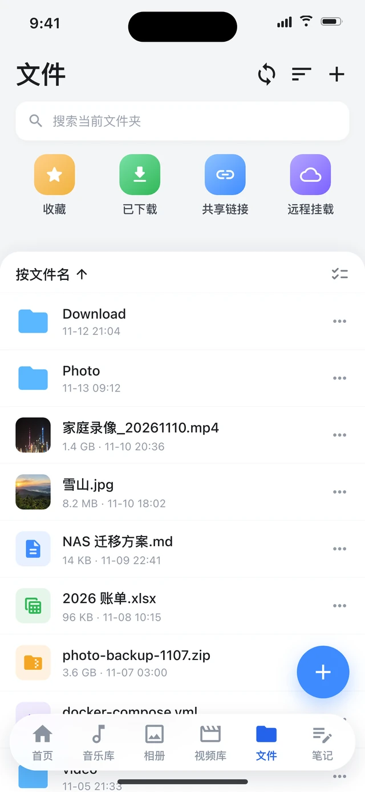<br/>文件管理</td>
    <td align="center">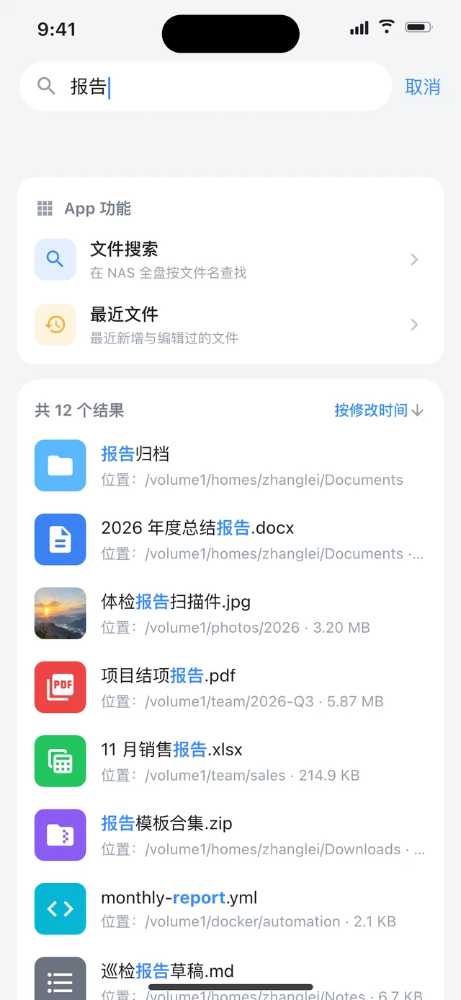<br/>全局搜索</td>
  </tr>
  <tr>
    <td align="center">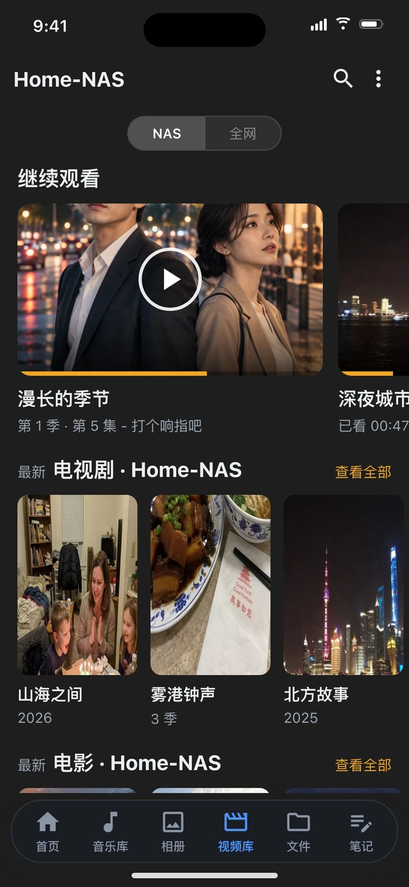<br/>影视海报墙</td>
    <td align="center">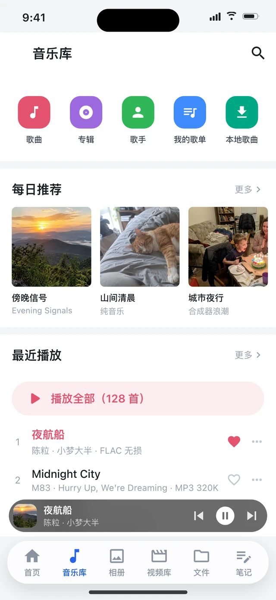<br/>音乐库</td>
    <td align="center">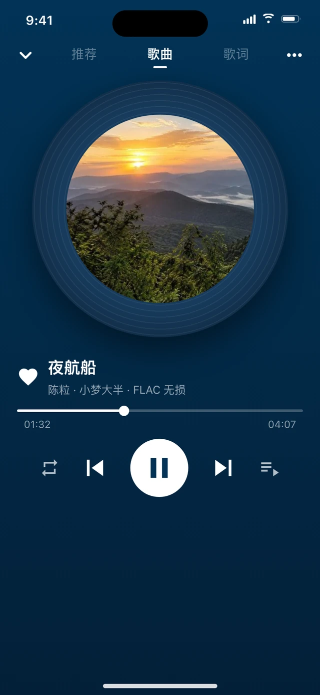<br/>播放器</td>
    <td align="center">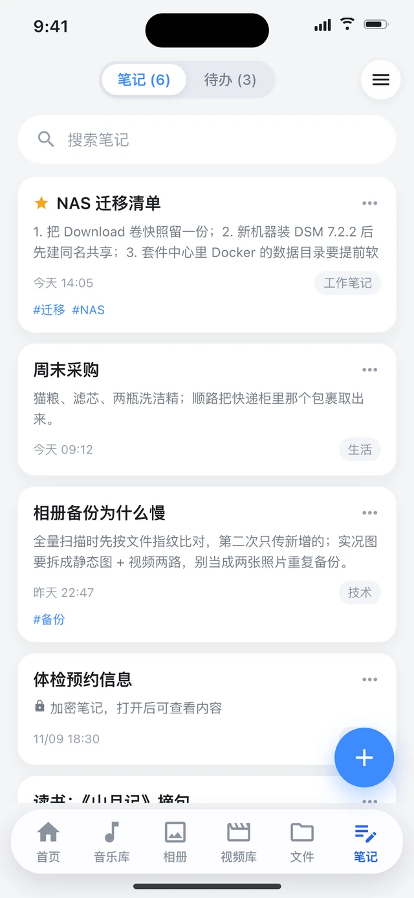<br/>笔记</td>
    <td align="center">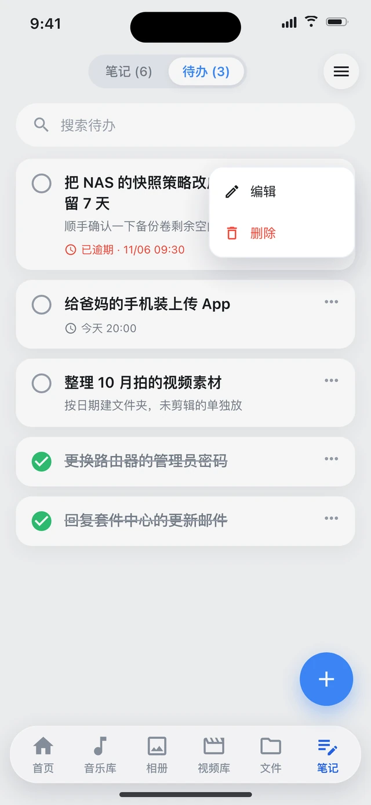<br/>待办</td>
  </tr>
  <tr>
    <td align="center">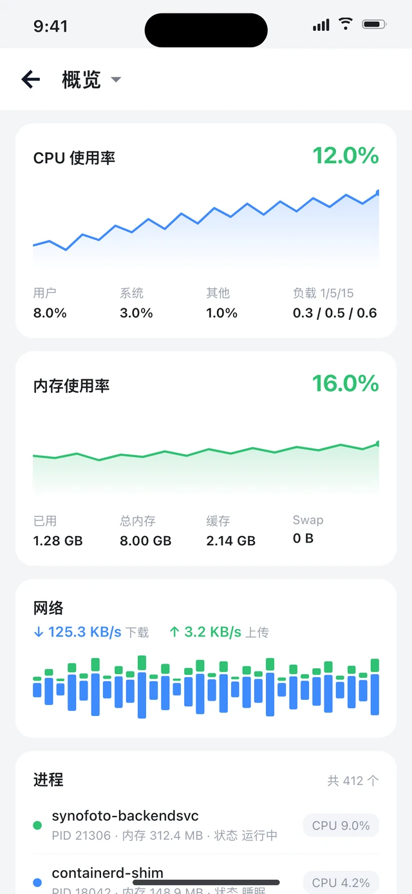<br/>资源监控</td>
    <td align="center">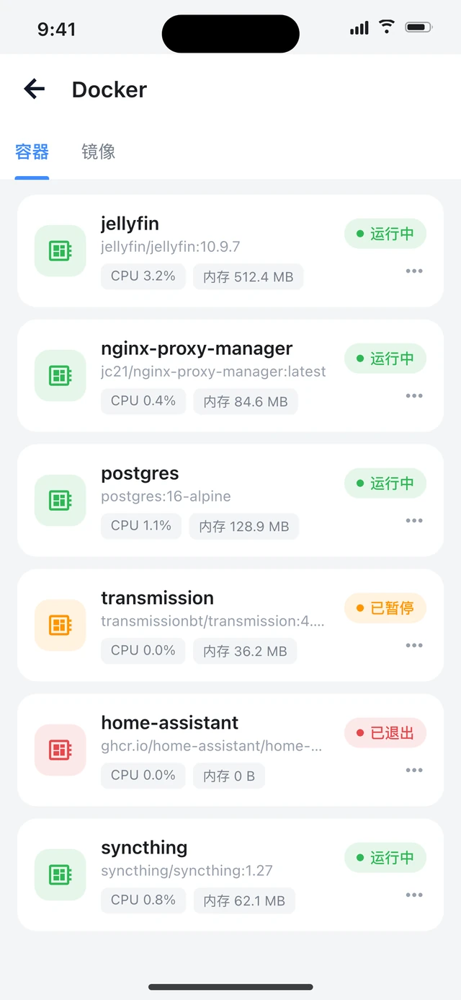<br/>Docker</td>
    <td align="center">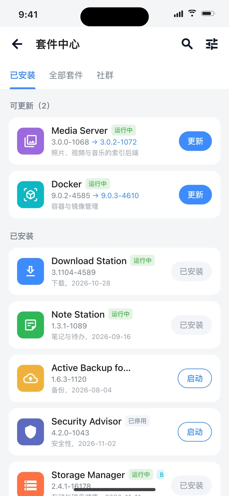<br/>套件中心</td>
    <td align="center">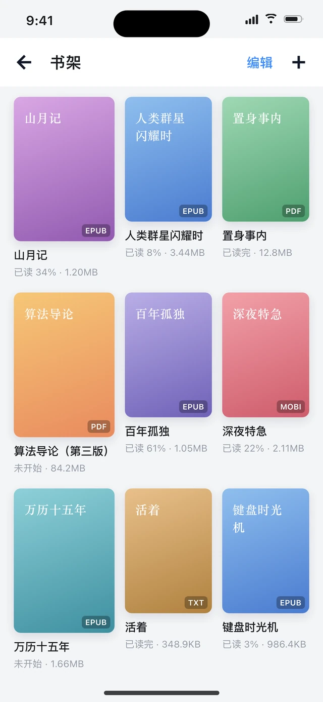<br/>书架</td>
    <td align="center"><br/>阅读器</td>
  </tr>
</table>

### 动效速览

<table>
  <tr>
    <td width="25%" align="center"><br/><b>相册时间线</b></td>
    <td width="25%" align="center">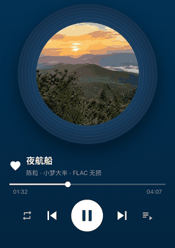<br/><b>音乐播放器</b></td>
    <td width="25%" align="center"><br/><b>封面自动修补</b></td>
    <td width="25%" align="center">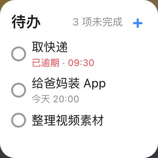<br/><b>桌面待办小组件</b></td>
  </tr>
</table>

------

## 功能地图

### 首页与系统

- **首页**：服务器与连接信息、存储用量、可自定义的功能宫格与底部 Tab 顺序
- **全局搜索**：搜文件、搜应用、搜功能入口，带搜索历史
- **套件中心 / 控制面板 / Docker**：安装与更新套件、开关 SSH、容器启停与日志
- **资源监控**：CPU / 内存 / 网络 / 存储实时曲线
- **存储管理**：存储空间、磁盘、SMART 与用量分布
- **安全扫描 / IP 封锁 / 日志中心 / 消息通知**：系统体检、自动封禁名单、日志告警与 DSM 消息中心
- **磁盘读写守护**：本机持续采样磁盘 I/O，异常读写时报警并可一键忽略；App 退到后台仍由前台服务保活，通知按钮的处置在引擎已销毁时照样生效
- **用户管理**：新增 / 编辑 DSM 用户

### 文件

- 浏览、上传、下载、搜索、新建文件夹、重命名、复制移动、删除、收藏
- 分享链接与权限管理、文件请求、共享文件夹权限编辑
- 压缩、最近文件、本地下载目录
- Markdown 编辑与阅读、多格式内置预览（图片 / 视频 / 音乐 / 文本）
- 左滑快捷操作与长按多选，批量下载 / 保存到相册

### 相册（Foto）

- 时间线 / 相册 / 文件夹 / 标签 / 地点 / 最近添加 / 视频 / 与我共享，个人空间与共享空间一键切换
- 「那年今日」回忆：本机按同月同日跨年匹配生成，不依赖服务端回忆接口
- 大图预览为一体式交互：下拉关闭、底部缩略图条、双击缩放、长按菜单、多选后共享 / 加相册 / 删除
- 实况照片角标与播放、封面自动修补：缺封面缩略图的视频与图片由本机自动生成封面并回传相册，当场出图
- 幻灯片播放、相册备份（增量检测 + NAS 侧去重）、图片编辑（裁剪 / 滤镜 / 涂鸦 / 打码）

### 视频

- 视频库浏览、内置播放器流式播放（NAS 转码与原画直连）
- 选集与自动连播、断点续看、悬浮小窗（Android 画中画）
- 播放会话隔离，销毁重建不留残帧

### 音乐（Audio Station）

- 音乐库 / 歌单 / 歌手 / 专辑浏览与搜索，后台播放与锁屏控制
- 歌词显示、播放队列、歌曲下载到本地

### 笔记（Note Station）

- 富文本编辑（表格 / 样式 / 图片）、加密笔记、记事本与标签管理
- 待办清单：新建 / 编辑 / 勾选完成 / 逾期标记，收藏与回收站
- **桌面待办小组件**（Android）：桌面上直接勾掉一条，点开直达待办页

### 电子书

- txt / epub 双渲染引擎（纯 Flutter 自绘与 WebView 可互切、可设默认）
- 仿真翻页与上下滚动、主题背景、字号行距、进度续读、目录跳转
- 书架管理，本地与 NAS 导入

### 传输与下载

- Download Station：BT / 磁力 / HTTP 任务管理与全局速度监控
- 上传 / 下载任务队列持久化、断点续传、完成自动打开

### Web 与账号

- 内置 WebView 与 Web 服务快捷入口，可添加自定义站点
- 系统分享 / 「用其他应用打开」直接传到 NAS（外部分享页有导航守卫，唤起失败不会乱跳）
- 会员权益与订阅、个人设置、应用锁定（指纹 / 面容）、公告与意见反馈、关于页

------

## 界面与交互

26.11 起完成了一轮整体改版，视觉与交互从 Material 默认样式换成自绘体系：

- **自绘组件**：底部 Tab（`FnBottomBar`）、玻璃悬浮条（`FnGlass`）、分段控件、输入弹窗、统计卡与迷你图表等，全部统一在 `lib/components/`
- **大屏适配**：一套自适应单位（`.aw` / `.asp` + `.r` / `.h`），手机、Pad、横屏各自有密度与尺寸口径；大图预览在 Pad 横屏下不裁切
- **深色模式**：跟随系统，配色与图表色板成对维护
- **一致性约束**：页面返回统一用 `PageBackButton`；危险操作（删除 / 格式化 / 重置）一律二次确认；缩略图尺寸与圆角有统一规格

详细规格与逐屏示例见 [docs/UI设计规范与示例.md](docs/UI设计规范与示例.md) 与 [docs/ui_redesign/](docs/ui_redesign/)。

------

## 架构

```
lib/
├── main.dart / app.dart / routes.dart   启动、根 Widget、路由表
├── pages/                               按业务模块划分的页面
│   ├── home/ files/ photos/ video/ music/ notes/ ebook/
│   ├── transfer/ common/ mine/ license/ login/ debug/
│   └── main_tab_page.dart               底部 Tab 宿主（Tab 顺序可配）
├── components/                          自绘 UI 组件库
├── core/                                业务服务与状态（备份、守护、传输、缓存、小组件…）
├── network/                             DSM API 客户端、加密与鉴权
├── models/ utils/                       数据模型与工具
└── vendor/fbr                           内置阅读引擎（本地改造版）
android/app/src/main/java/               原生能力（通知、前台服务、深链、小组件）
test/                                    单元与 Widget 测试
release/                                 打包与发布脚本
```

**网络与鉴权**：所有 DSM 请求走 `lib/network/dsm_api.dart`，统一处理 `entry.cgi` 签名、Cookie / `_sid`、SynoToken（写操作必需）与错误码。会话失效（119 等）有静默重登兜底。`lib/network/dsm_crypto.dart` 用纯 Dart 实现了 RSA-PKCS1 与 Note Station 的加密便签解密，不引入额外原生依赖。图片 / 缩略图请求复用与网络层完全一致的鉴权头，避免「列表有图、大图灰掉」。

**原生侧只有五种事**（channel 一览）：

| channel | 作用 |
| --- | --- |
| `app.share_intents` | 系统分享 / 「用其他应用打开」进入 App，冷启动有暂存兜底 |
| `app.navigation` | 导航与外部跳转 |
| `app.pip` | Android 画中画悬浮小窗 |
| `app.privacy` | 跳转系统安全设置等 |
| `app.download` + `app.download.events` | 原生下载服务与进度事件 |
| `app.guard` | 磁盘守护的前台服务、通知、忽略时刻（原生侧权威存储） |
| `app.lifecycle_signals` | 补充生命周期信号（区分主动切走与瞬时遮罩） |
| `app.widget` | 桌面待办小组件的快照下发与勾选回传 |

原则是**能在 Dart 做的绝不下沉到原生**：原生只做系统能力（服务、通知、小组件、分享），业务口径始终只有一份，在 Dart。

**本地数据**：偏好走 `shared_preferences`（`AppPreferences` 统一封装），列表缓存带签名比对以避免刷新时的闪跳，图片走 `cached_network_image_ce` 磁盘缓存，视频封面另有本机抽帧缓存。清理策略与保留时长在 `lib/core/` 各自服务里说明。

**阅读引擎**：`lib/vendor/fbr` 是随仓库一起维护的本地版本，改过纵向滚动的分段块切分与定位精度，升级时要手工合并，不能直接换 pub 版本。

------

## 技术栈

Flutter / Dart · `dio` · `media_kit`（libmpv 内核，视频与音乐统一）· `audio_service` + `audio_session` · `photo_view` · `cached_network_image_ce` · `webview_flutter` + `flutter_inappwebview` · `flutter_screenutil` · `permission_handler` · `shared_preferences` · `path_provider` · `photo_manager` + `gal` · `file_picker` / `open_filex` / `share_plus` · `pro_image_editor` · `local_auth`（应用锁定）· `connectivity_plus` · `crypto` · `archive` + `xml`（epub 解析）· `skeletonizer` · `easy_refresh` · `flutter_slidable`

选型原则：**功能优先、零依赖优先**。新库要先评估对包体积与实际需求的必要性，能自绘或纯 Dart 实现的不引原生依赖。

------

## 快速开始（开发）

### 环境

- Flutter stable（项目 `pubspec.yaml` 的 `sdk` 约束为准），Android 端 compile/target SDK 36、minSdk 24
- Android：JDK 17 + Android SDK（仅 `arm64-v8a`）
- iOS：Xcode + CocoaPods（项目已在 `pubspec.yaml` 里关掉 Swift Package Manager，依赖管理以 CocoaPods 为准）

```bash
cd synology_cloud_flutter
flutter pub get
flutter run                 # 调试
```

### Android 构建

```bash
flutter build apk --release --target-platform android-arm64
```

只出 arm64 单架构包：`android/app/build.gradle.kts` 里除 `abiFilters` 外还硬排除了插件 AAR 自带的 `armeabi-v7a` / `x86` / `x86_64` so（`abiFilters` 管不住它们）。不要用 `--split-per-abi`——它会把 versionCode 改写成 `ABI*1000 + buildNumber`，App 内的版本比对会错乱。核验产物：

```bash
unzip -l build/app/outputs/flutter-apk/app-release.apk | grep ' lib/'   # 应只剩 lib/arm64-v8a/
```

### iOS 构建

```bash
flutter build ios --release --no-codesign     # 需要无签名 ipa 时用 --no-codesign
```

免费 Apple ID 签名的包有效期 7 天，到期重签即可，数据不丢。

### 静态检查与测试

```bash
flutter analyze            # 基线 0 error（剩余的 info 多为历史风格提示）
flutter test               # 全量用例（600+）
```

改动前建议先看目标模块有没有对应测试文件（`test/` 按模块命名，如 `foto_*`、`note_*`、`video_*`），行为契约写死在测试里，改坏会直接报出来。

### 真机排查

App 内日志入口：**关于页版本号连点 5 下 → 悬浮球 → 调试页 › 本地日志 › 查看日志**。抓到的接口请求在调试页的网络抓包里能看到。加日志用 `LocalLogger.d/w/e(tag, message)`，不要用 `print`。

------

## 下载与安装

### Android

👉 [官网下载](http://zhanglei.nasfuns.fun:4001/website/)


### iOS

IPA 同样从[官网](http://zhanglei.nasfuns.fun:4001/website/)获取。**未上架 App Store**，包无 Apple 商业签名，需要自行侧载。

<details>
<summary><b>iOS 侧载安装步骤</b></summary>

1. 电脑打开 [sideloadly.io](https://sideloadly.io/) 下载 Sideloadly
2. 把 `.ipa` 拖入 Sideloadly，iPhone 用 USB 连接电脑
3. 填入 Apple ID 用于签名，点 Start 安装
4. 手机上「设置 → 通用 → VPN 与设备管理」信任开发者证书

> 免费 Apple ID 签名有效期 7 天，到期重连电脑点一次 Start 续期，数据不丢。

</details>

------

## 产品演示

<table>
  <tr>
    <td align="center">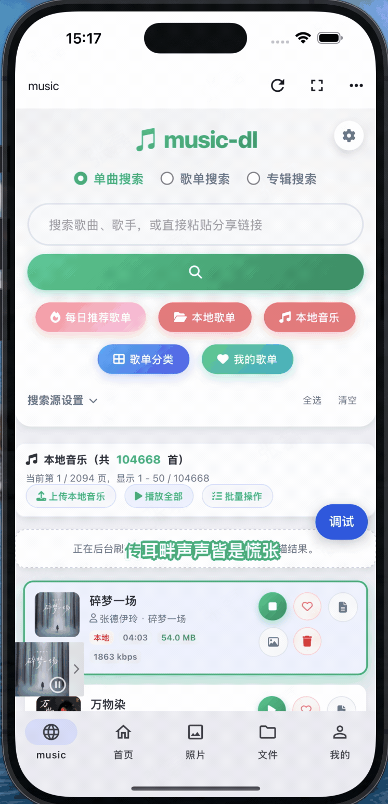<br/>文件管理</td>
    <td align="center">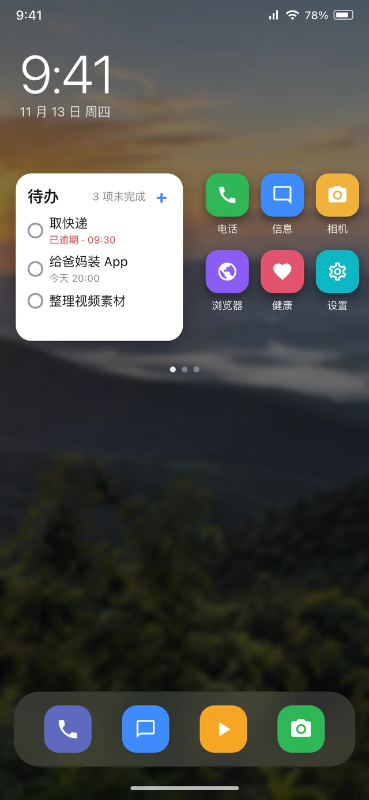<br/>桌面小组件实况</td>
  </tr>
</table>
------

## 为什么做这件事

官方把文件、照片、音乐、视频拆成了几个独立 App，日常要在它们之间来回跳。NasFlow 想做的是：一台 NAS，一个 App 管完，同时把交互做得更贴合本地习惯——更紧凑的导航、更跟手的列表操作、大屏也不浪费的排版。

新加的能力基本都来自用户反馈，例如磁盘异常读写守护、断点续看、桌面待办小组件、「那年今日」。

------

## 参与与反馈

欢迎提 Issue、功能建议与 PR。如果你也是 NAS 用户，很欢迎一起把它磨顺手。

产品建议可以直接在 App 内提交：

> **关于 NasFlow → 意见反馈**

被采纳的建议会同步进：

> **关于 NasFlow → 公告 / 开发计划**

------

## License

本项目基于 **GPL-3.0** 协议开源。

## 声明

NasFlow（原 Synology Cloud）为第三方独立开发的 NAS 管理客户端，与 Synology 无隶属关系；DSM 及相关服务名称归其权利人所有。项目仅在你授权范围内使用你的账号访问你自己的 NAS。
